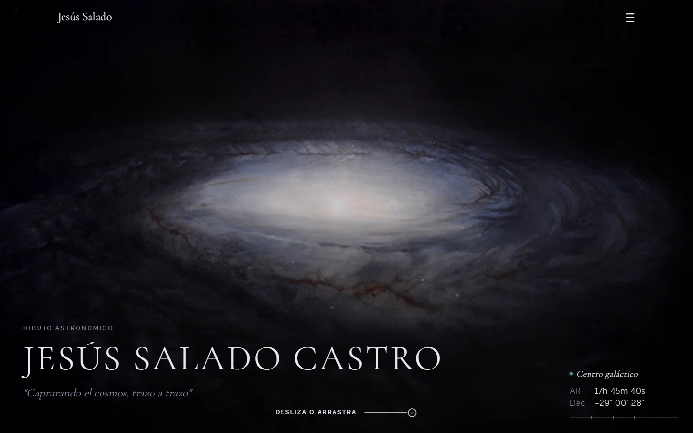
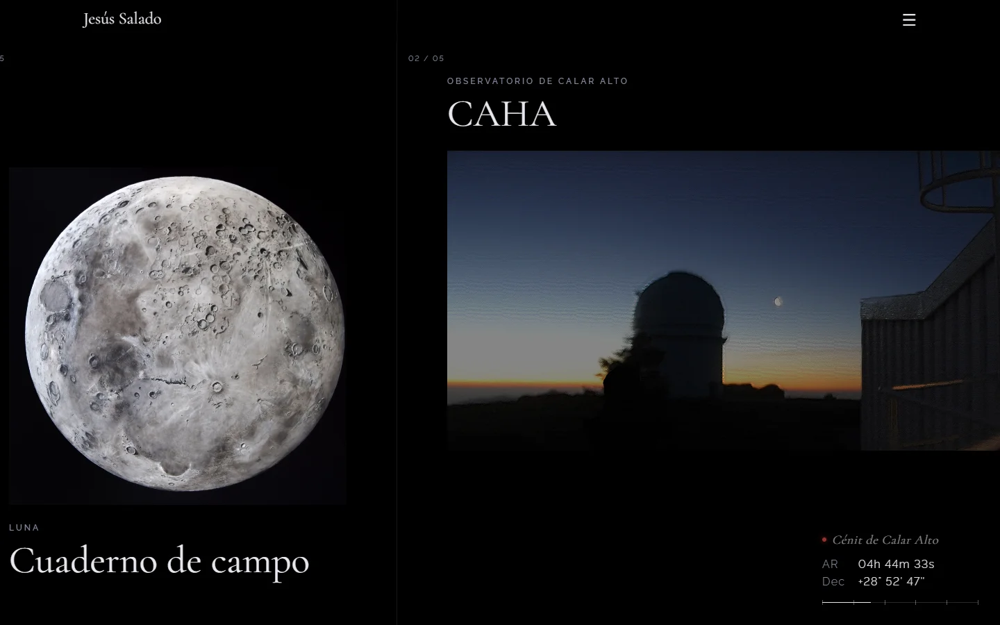
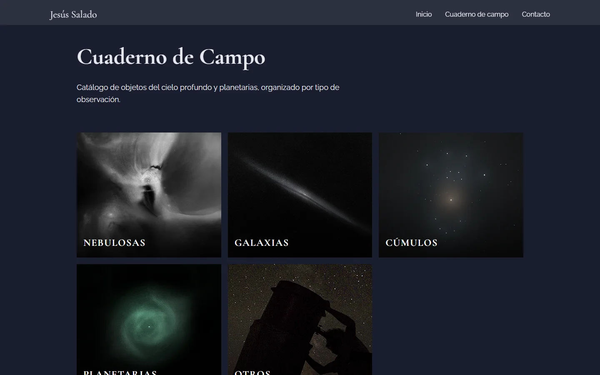
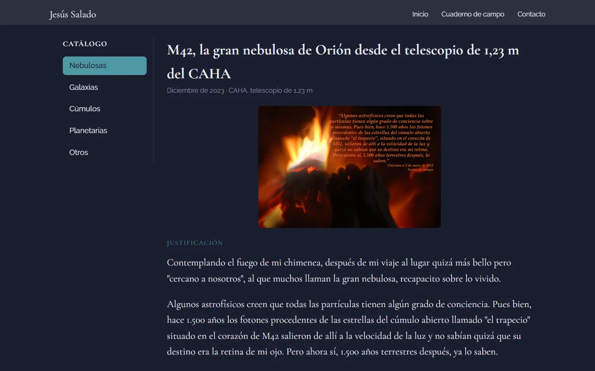
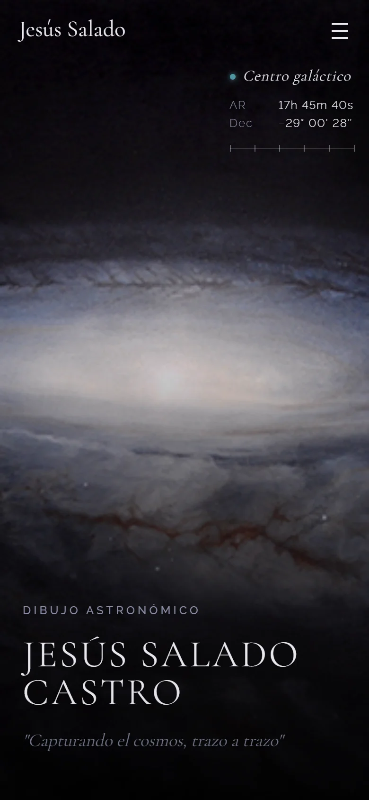

# Jesús Salado · Dibujo astronómico

Web de los dibujos astronómicos de **Jesús Salado Castro**: observaciones del cielo dibujadas a mano, desde el patio de casa hasta el telescopio de 1,23 m del Observatorio de Calar Alto (CAHA). Proyecto real para un cliente, desarrollado desde cero: desde la toma de requisitos hasta el despliegue.

🔭 **[dibujoastronomico-jesussalado.vercel.app](https://dibujoastronomico-jesussalado.vercel.app)**



<table>
  <tr>
    <td></td>
    <td></td>
  </tr>
  <tr>
    <td></td>
    <td align="center"></td>
  </tr>
</table>

## Qué incluye

- **Home con scroll horizontal:** la portada queda fija y las láminas entran desde la derecha tapándola. Se puede avanzar con la rueda del ratón (con inercia), arrastrando, con las flechas del teclado o con el trackpad. En móvil se convierte en una lista vertical.
- **Indicador de coordenadas celestes:** muestra la ascensión recta y la declinación del objeto que está en pantalla, y las va girando al pasar de uno a otro, como un telescopio apuntando.
- **Cuaderno de campo:** catálogo de observaciones por categoría (nebulosas, galaxias, cúmulos, planetarias…) con un artículo detallado para cada dibujo.
- **Diseño adaptado** a escritorio, tablet y móvil, y con respeto a la preferencia de reducir animaciones.

## Detalles técnicos

- **Scroll horizontal sin librerías** (`useHorizontalStrip`): convierte el scroll vertical en desplazamiento horizontal con interpolación por frame (`requestAnimationFrame`), y añade arrastre con inercia al soltar, navegación con teclado y gestos de trackpad. Distingue un arrastre de un clic para no abrir enlaces por accidente.
- **Coordenadas que "giran" como un telescopio** (`CelestialCoords`): interpola la ascensión recta y la declinación entre objetos, toma el camino más corto en ascensión recta (que da la vuelta en 24 h) y actualiza el DOM directamente para no provocar un render de React en cada frame.
- **Carga bajo demanda**: cada página y cada artículo del cuaderno es un chunk independiente (`React.lazy`), así que la portada no descarga el contenido del resto.
- **Contenido separado del código**: las láminas de la home y las fichas del cuaderno viven en `src/data/`, lo que permite añadir observaciones sin tocar los componentes.

## Tecnologías

- [React 19](https://react.dev)
- [Vite](https://vite.dev)
- [React Router](https://reactrouter.com)
- CSS sin frameworks, con anidamiento nativo
- Desplegada en [Vercel](https://vercel.com)

## Puesta en marcha

Requiere [Node.js](https://nodejs.org) 20 o superior.

```bash
npm install
npm run dev
```

| Comando           | Qué hace                                   |
| ----------------- | ------------------------------------------ |
| `npm run dev`     | Servidor de desarrollo con recarga en vivo |
| `npm run build`   | Genera la versión de producción en `dist/` |
| `npm run preview` | Sirve la versión de producción en local    |
| `npm run lint`    | Revisa el código con ESLint                |

## Estructura

```
src/
├── components/      Componentes reutilizables (Navbar, Hero, CelestialCoords…)
├── data/            Contenido: artículos y láminas de la home
├── hooks/           Lógica reutilizable (scroll horizontal de la home)
├── pages/           Páginas de cada ruta
│   └── Notebook/
│       └── articles/    Un componente por artículo del cuaderno
├── routes/          Definición de rutas
├── styles/          Variables y estilos globales
└── utils/           Funciones auxiliares (formato de coordenadas, cálculos de scroll)

public/images/notebook/   Imágenes de los artículos, una carpeta por objeto
```

## Cómo añadir contenido

### Un artículo nuevo al cuaderno de campo

1. Guarda las imágenes en `public/images/notebook/<OBJETO>/`.
2. Añade la ficha del artículo en `src/data/articles.js` (título, categoría, fecha, lugar, resumen e imagen de portada).
3. Crea el componente del artículo en `src/pages/Notebook/articles/<OBJETO>/`, tomando como referencia `M42` o `NGC869`.
4. Regístralo en `src/pages/Notebook/articles/index.js` con el mismo `slug` que en la ficha.

### Las láminas de la home

Se editan en `src/data/homeSlides.js`: imagen, título, etiqueta, enlace y coordenadas del objeto (ascensión recta en horas y declinación en grados, J2000). La composición de cada lámina (tamaño y alineación) está en el array `LAYOUTS` de `src/components/Hero/Hero.jsx`.

## Autoría

Dibujos y textos: **Jesús Salado Castro**.
Diseño y desarrollo web: **Alejandro Salado Sánchez** · [Portfolio](URL_DEL_PORTFOLIO) · [LinkedIn](https://www.linkedin.com/in/alejandro-salado/) · [GitHub](https://github.com/alex-salsan)

Las imágenes de los dibujos pertenecen a su autor y no deben reutilizarse sin permiso.
